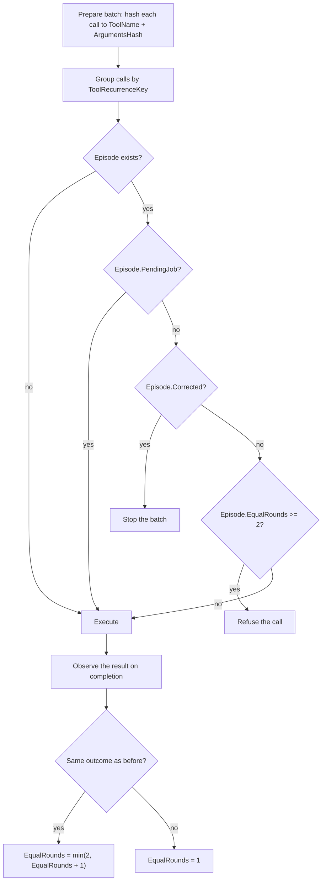

# Loop Detector

## Purpose

The loop detector stops the model from repeating a failing tool call (a "doom
loop"). It replaces the old hard tool-iteration budget. The old budget stopped
the model after a fixed number of calls, whether or not it was looping. The
loop detector stops the model only when it repeats the *same action* with the
*same outcome*.

## The one rule

The same *(tool + arguments)* producing the same *outcome* twice causes the
third dispatch of that action to be refused.

## Prepare: reduce each call to a recurrence key

Before dispatch, the detector reduces every tool call in a batch to a key:

- `ToolName` — the canonical tool name.
- `ArgumentsHash` — a SHA-256 of the canonical JSON arguments. Object keys are
  sorted, so key order cannot hide an equal action.
- an `accepted` / `rejected` marker plus the deny reason, so a repaired call
  differs from a rejected one.

The pair `(ToolName, ArgumentsHash)` is a `ToolRecurrenceKey`.

## Decide: refuse repeats

For each key the detector keeps an *episode*:

- `Outcome` — the hash of the result (its category plus its visible text).
- `EqualRounds` — how many consecutive rounds produced the same outcome (capped
  at 2).
- `Corrected` — this key was already blocked.
- `PendingJob` — this key is a background-job status poll (exempt).



## Pseudo-code

```
function EvaluateBeforeDispatch(batch):
    refused = {}
    exempt  = {}
    for each group of calls sharing a (ToolName, ArgumentsHash) key:
        if key has no episode: continue
        if episode.PendingJob:  add group to exempt; continue
        if episode.Corrected:   return Stop
        if episode.EqualRounds >= 2:  add group to refused

    if nothing was exempted:
        run the adjacent-sequence check (below)

    mark every refused group as Corrected
    return refused.empty ? Execute : Correct(refused)

function ObserveGroup(key, outcome):
    episode = episodes[key]
    if episode exists and episode.Outcome == outcome:
        episode.EqualRounds = min(2, episode.EqualRounds + 1)
    else:
        episode.EqualRounds = 1
    episode.Outcome = outcome
```

## The trace

The model repeatedly calls `file_edit` with an empty body (only `_rationale`,
no `OldString`/`NewString`). Netclaw rejects each call before it changes
anything.

| Step | Tool call | Episode state for `(file_edit, H)` | Decision |
|---|---|---|---|
| 1 | `file_edit(path="doc.md", _rationale=…)` | none | execute → Netclaw rejects |
| 2 | same call, same arguments | `EqualRounds = 1` | execute → rejected again |
| 3 | same call, same arguments | `EqualRounds = 2` | **refuse** — "same action completed twice" |
| 4 | same call, same arguments | `Corrected` | **stop** |

Steps 1 and 2 both complete with the same "rejected" outcome, so `EqualRounds`
reaches 2. Step 3 is refused before it runs. Step 4 is stopped because the key
was already corrected.

## Counterexamples

- **Different arguments.** `spawn_agent(task="A")` then `spawn_agent(task="B")`
  produce different `ArgumentsHash` values, so different keys. Nothing is
  refused. Launching three different sub-agents never trips the guard.
- **A changed result.** When the model repairs the call — it adds `OldString`
  and `NewString` — the arguments hash changes and a fresh episode begins. The
  old key is irrelevant.
- **Background polling.** `check_background_job(run_id=…)` is exempt: polling
  "is it done yet?" is legitimate repetition, not a loop.

## The PendingJob exemption

A background child runs while the parent polls `check_background_job`. Polling
is the same tool with the same arguments and the same "still running" outcome —
which would otherwise look like a loop. The detector marks non-cancel
`check_background_job` calls as `PendingJob` and exempts them, so polling never
trips the guard.

## The adjacent-sequence layer

As a second layer, the detector also compares *completed batches* — a hash of
the ordered tool calls plus their outcome. When the same sequence of up to
three batches completes twice and the next batch repeats it, the detector
corrects it. This catches a loop that cycles through several tools in a
repeating pattern, not just one repeated call.

## Non-goals

- **In-memory only.** The detector state resets every turn and on every
  restart. It is not persisted.
- **No durability.** A loop that spans a restart re-arms within two rounds;
  nothing is carried over.
- **Not a budget.** There is no tool-count or token ceiling. Long legitimate
  work is never stopped.
